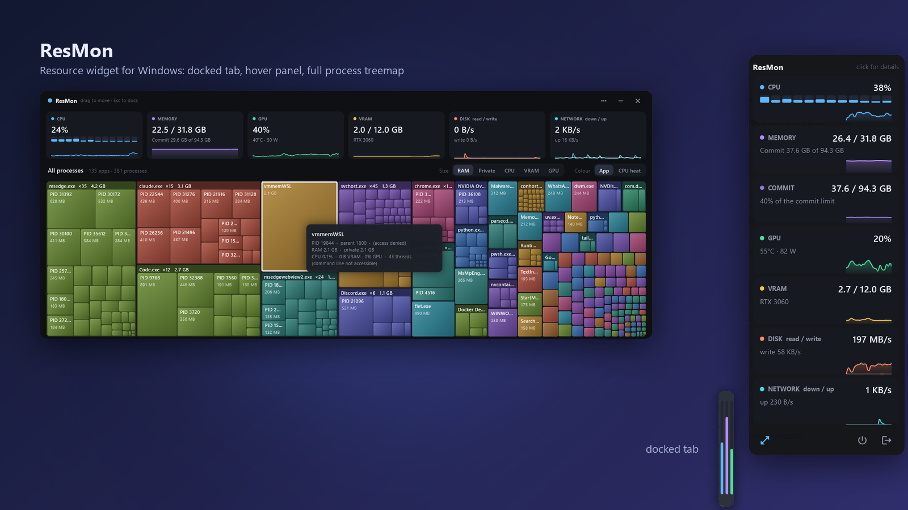

# ResMon

A resource monitor for Windows that lives on the edge of your screen instead of in a window.

<p align="center">
  
</p>

Task Manager tells you numbers. ResMon shows you **who is eating your machine**: every process is a
tile, sized by what it uses, grouped by app. It stays out of the way as a thin tab on the right edge
and opens only when you reach for it.

## Three states, one widget

| State | How you get there | What you see |
|---|---|---|
| **Tab** | always there | A slim tab docked on the right edge, always on top, no taskbar button. Three live bars: CPU, RAM, GPU. |
| **Panel** | hover the tab | Slides in from the edge: CPU per core, memory, commit, GPU (load, temperature, power), VRAM, disk and network, each with a 60 s sparkline. Folds back when the mouse leaves. |
| **Full view** | click the tab or the panel | A squarified treemap of all processes plus a sortable, searchable table. `Esc`, `-` or `x` docks it back to the tab. |

## What you can do in the full view

- **Size the treemap by** RAM, private bytes, CPU, VRAM or GPU load. Colour by app or by CPU heat.
- **Hover** a tile for PID, parent, RAM, CPU, VRAM, GPU and threads. **Double-click** an app to see its processes.
- **Act on the selection:** copy PID, copy command line, open file location, set priority, end task (optionally the whole process tree).

## Install

Windows 10/11 and Python 3.11+.

```
git clone https://github.com/FrancescoCorrenti/ResMon.git
cd ResMon
pip install -r requirements.txt
```

Start it with `run.bat` (no console window). To start it at logon, use **Start with Windows** in the
panel or in the `...` menu of the full view. **Quit** is in the same places.

## How it works

- **Processes:** one `NtQuerySystemInformation` call per tick (about 15 ms), instead of iterating
  processes one by one (over a second with psutil on a busy machine).
- **Per-process GPU:** Windows PDH counters `GPU Engine` and `GPU Process Memory`, read by their English
  names so it also works on localized Windows. NVML (`nvidia-ml-py`) adds GPU temperature and power on
  NVIDIA cards; without one ResMon still runs, just without those two values.
- **Smooth, not busy:** totals are sampled every 0.5 s, processes every 1.5 s and only while the full
  view is open. Bars slide, sparklines are smoothed curves, and treemap tiles glide to their new place,
  reflowing at most every 8 s, with hysteresis so small changes do not shuffle the layout. Docked, it
  uses well under 1 % of a mid-range CPU.

## Limits

- Without administrator rights, some system processes cannot be ended or reprioritised and their command
  line cannot be read. ResMon tells you when that happens.
- Windows enforces a minimum window width, so the docked window extends past the right edge of the
  primary monitor. With a second monitor placed to the right, it covers a thin strip of it.
- Windows only.

## Development

`python core.py` runs the treemap layout self-check. `selftest.py` drives the app end to end (spawns a
dummy process to test copy and kill, checks every way back to the tab and measures its own CPU); run it
with `set RESMON_TEST=full` or `set RESMON_TEST=dock`, then `pythonw app.py`. Output goes to
`docs/selftest/`. `tools/make_hero.py` builds the README image from three screenshots.

## License

MIT
