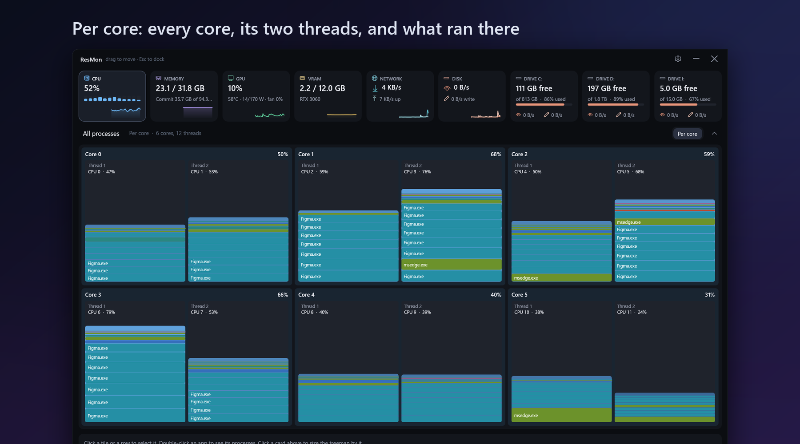
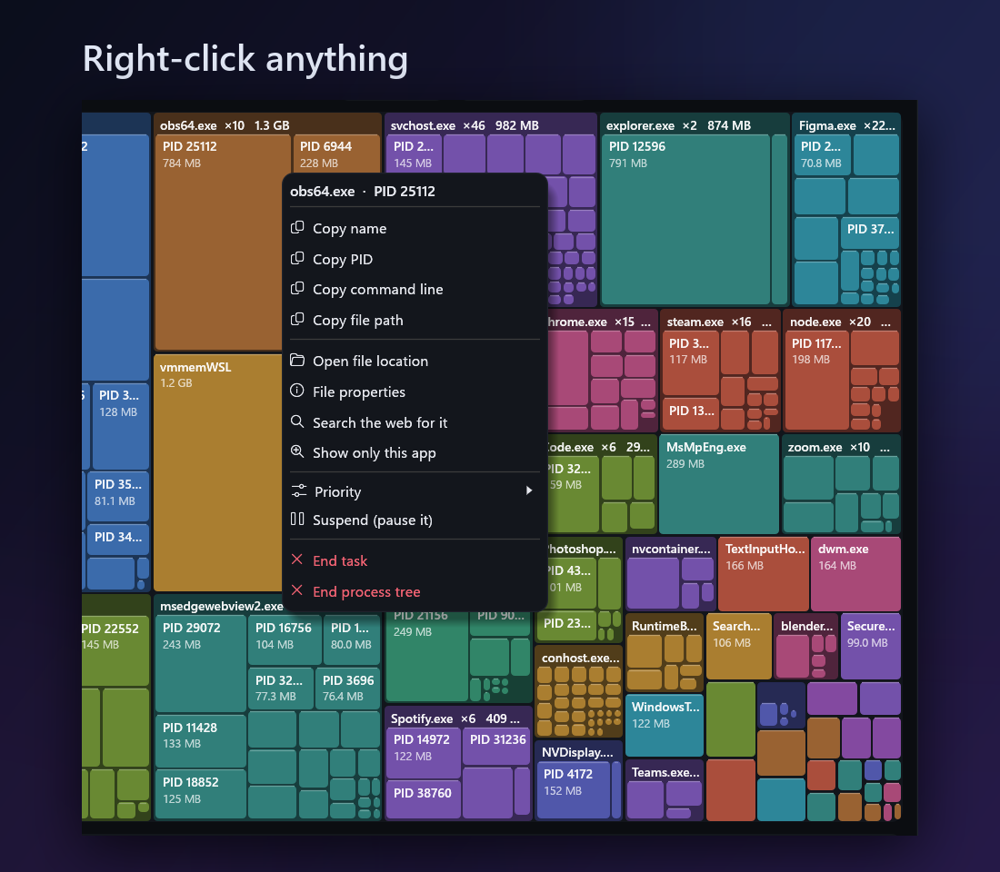

# ResMon

**See who is eating your machine.** A resource monitor for Windows that lives on the edge of your screen
instead of in a window.


<p align="center">
  
</p>

Task Manager gives you a list of numbers. ResMon draws **every process as a tile** sized by what it uses,
grouped by app, so the culprit is the biggest thing on screen. Most of the time it is just a slim tab on
the right edge of the screen; it opens when you reach for it. One 6 MB executable, about 35 MB of memory,
under 1% of one CPU core.

<sub>Screenshots taken in demo mode: real measurements, app names swapped for common ones.</sub>

## Three states, one widget

| | How you get there | What you see |
|---|---|---|
| **Tab** | always there | A slim tab on the screen edge, always on top, no taskbar button. Live bars for the measures you pick (CPU, memory, GPU, VRAM, network, disk). Drag it to any height or monitor. |
| **Panel** | rest the mouse on the tab | Slides out of the edge: CPU per core, memory, commit, GPU (load, temperature, power, fan), VRAM, network, disk, free space per drive, each with a sparkline. |
| **Full view** | click the tab or the panel | A treemap of all processes and a searchable table. `Esc` docks it back. |

## What it shows

<table>
<tr>
<td width="50%"></td>
<td width="50%"></td>
</tr>
<tr>
<td><b>Per core.</b> Every physical core with its two threads, each filled by its load and split into the processes that ran there.</td>
<td><b>Right-click anything.</b> Copy name, PID, command line or path, open its folder, search the web for it, change priority, pause it, end it or its whole tree.</td>
</tr>
</table>

- **Size the map by anything:** click a card. Memory (working set or private), CPU, GPU load, VRAM.
- **Disk and network, split in two:** who reads | who writes, who downloads | who uploads, per process.
- **What fills a drive:** click a drive to see it folder by folder. The scan runs in the background at low
  priority, is cached, and **Refresh** rescans only what changed. **Changes** shows what grew since last time.
- **ML storage:** one card for the Hugging Face, torch, Ollama, LM Studio, pip and conda caches, wherever
  they are.
- **24 h history:** a strip over the map with the top processes every 10 s. Click a moment to see the map
  as it was.
- **Quiet alerts:** RAM, commit, VRAM, CPU, GPU temperature and slowdowns, a nearly full drive. Only when the
  condition lasts, with the process to blame. A dot on the tab and a line in the full view, never a pop-up.
- **Families:** group processes by the app that launched them (every `python.exe` of one training run
  under its terminal) instead of by name.
- **Share of total:** tiles sized against the whole machine, with what no process accounts for and what is
  free as their own tiles.
- **Settings:** dark, black or light theme, accent colours, which cards to show, which bars on the tab,
  hover delay. Everything you choose is remembered.

## Install

Windows 10 or 11. Build it with [Rust](https://rustup.rs) (stable, MSVC toolchain):

```
git clone https://github.com/FrancescoCorrenti/ResMon.git
cd ResMon
cargo build --release
```

Run `target\release\resmon.exe`. It is self-contained: copy it anywhere. **Start with Windows** and **Quit**
are in the panel and in the menu of the full view.

To run it as administrator without a UAC prompt every time (needed to end or reprioritise system
processes and read their command lines), run `tools\install-admin.ps1` once from an elevated PowerShell.
It registers a scheduled task with highest privileges and points the Desktop shortcut and the logon start
at it.

## How it works

- **No GPU, on purpose.** A GPU renderer loads the graphics driver into the process: on an NVIDIA machine
  OpenGL alone added about 140 MB and wgpu about 440 MB, for a few bars and a treemap. ResMon draws
  [egui](https://github.com/emilk/egui)'s triangles with its own small CPU rasterizer (`src/raster.rs`) into
  a layered window, which gives real per-pixel transparency: clicks pass through the rounded corners.
- **Only what changed is redrawn.** Each frame is compared with the previous one primitive by primitive,
  and frames happen only when something changed.
- **Processes:** one `NtQuerySystemInformation` call per tick for all of them, instead of opening each one.
- **Per-process network without administrator:** a real-time ETW session on the Winsock provider, running
  only while the full view is open (`src/net.rs`).
- **Per core:** where a thread ran is known only to a kernel trace. ResMon starts from each thread's ideal
  processor and balances the table so that each process sums to its measured CPU time and each CPU to its
  measured load. Loads are measured; which process ran where is an estimate.
- **GPU:** the PDH counters `GPU Engine` and `GPU Process Memory` (by their English names, so localized
  Windows works too), plus NVML on NVIDIA cards for temperature, power, fan, clocks and the reasons the GPU
  is slowing down. Without an NVIDIA card those values are simply missing.
- **Safe actions:** end, pause and priority check that the PID still belongs to the process you clicked,
  refuse processes Windows cannot lose (`csrss`, `lsass`, `svchost`, `dwm`...), and are off while you look
  at the past.

## Limits

- Without administrator rights some system processes cannot be ended or reprioritised, and their command
  line cannot be read. ResMon says so when it happens.
- Windows only.

## Development

- `cargo test` checks the treemap layout, the rasterizer, the system readers, the network trace (loopback)
  and the drive scanner.
- `RESMON_OPEN=panel|full` opens that state at start. `RESMON_SCRIPT="2:click:110,130; 4:shot"` plays
  clicks and writes frames to `%TEMP%`. `RESMON_DEMO=1` renames processes to common apps, for screenshots.
  `RESMON_LOG=1` writes per-frame timings to `%TEMP%\resmon.log`.
- `tools/compose_hero.py` builds the README images from those frames; `tools\perf.ps1` measures ResMon's own
  CPU and memory.

The first version was written in Python with Flet: it is the history of `main` up to `4232e53`.

## License

MIT
